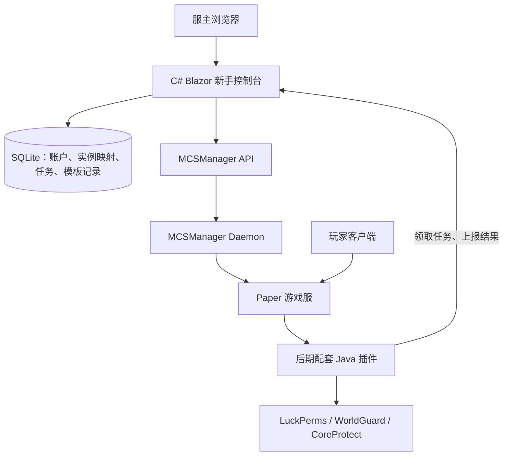

# Minecraft 新手开服工具：项目实施方案

日期：2026-10-27。适用对象：具有 C#／C++ 基础、第一次开发完整项目的个人开发者。

本文是可逐阶段执行的设计与实施路线，不是已完成的软件。上游安装命令、.NET 初始化命令可以实际使用；自有安装器、业务接口、模板和插件均是待开发内容。未进行整套集成安装测试。

## 1. 先确定产品与技术路线

目标：让不懂 Linux 的服主，在浏览器里完成创建服务器、选择版本、启动、邀请朋友、分配角色、保护建筑和安装经过筛选的扩展。

这里的 Linux／Windows 首先指服务器主机系统；玩家使用什么系统是另一回事。同一 Java 版服务端一般通过对应 Java 运行时跨平台运行，无需为 Windows 与 Linux 分别改造 Minecraft 内核。需要适配的是安装、路径、服务管理和运行依赖。

建议路线：**C# 新手控制台 + 原版 MCSManager 作为管理引擎 + 精选服务端模板 + 后期配套 Paper 桥接插件。**

你负责新手流程与功能整合；上游负责成熟的进程、终端、文件和实例管理。初期不修改 MCSManager 核心源码。首次设置管理引擎、生成 API Key 可以暂时人工完成，后续才把这部分自动化。

为什么采用这条路线：

| 路线 | 优点 | 对你的主要成本 | 建议 |
|---|---|---|---|
| 直接使用 MCSManager | 最快可用，现成功能多 | 产品仍然是上游界面 | 第 0 阶段先这样做，作为功能基线 |
| Fork MCSManager，增加新手模式 | 原有 UI、认证、管理能力都能复用 | 需学习 TypeScript、Vue、Koa，并长期合并上游修改 | 如果你愿意转向 Web 技术栈，这是很合理的备选 |
| C# 控制台调用 MCSManager API | 使用你已有的 C# 基础；和上游通过接口连接 | 多维护一个应用，需做自己的面板认证和 API 适配 | 本方案主路线 |
| C# 自己控制 Docker／Java 进程 | 完全自由 | 需要重新实现实例、文件、日志、重启恢复等大量功能 | 暂不采用 |

这条路线仍需要学习 Web 开发，但无需同时从零学习 Vue，也无需重写成熟的管理引擎。控制台与管理引擎是两个服务，这是一项明确的取舍。

**第一项技术验证：**先证明 C# 能通过 API 获取一个实际 Minecraft 实例的状态、启动它并正常停止。验证通过后再设计更多页面。

## 2. 第一版范围：把愿景拆成几个可交付版本

### v0.1：先交付“能开服”

- 单台机器、一个服主账户、一个受支持的 Paper 模板。
- 可管理多个实例，但开发验证先只用一个实例。
- 在网页选择名称、内存、人数、游戏模式和白名单策略。
- 显示创建进度、运行状态、最近日志。
- 启动、正常停止、重启。
- 显示连接地址和联网检查结果。
- 停服一致性备份、恢复到独立测试实例。
- 默认保留正版验证；首次启动前明确接受 Minecraft EULA。
- 本地 Windows 开发；Linux 发布先只支持 Ubuntu 24.04 LTS x86_64。

v0.1 不包含：领地网页编辑、任意 Mod 市场、基岩版、跨节点集群、商业租服计费、自动处理所有路由器或云厂商。

### v0.2：让管理方便

- 白名单和玩家列表。
- 精选插件包的安装、卸载和兼容性说明。
- 官方身份验证基础上的邀请／审核流程。
- 有计划的备份保留策略。
- 更新前备份、失败后的明确恢复入口。

### v0.3：统一角色与区域

- Paper 桥接插件。
- 网页角色分配与游戏内角色同步。
- 游戏内选择两个角点、预览边界；网页选择保护模板。
- 领地主人、成员、访客管理。
- WorldGuard 管理员区域与私人领地的基础规则。
- 操作记录查询；回滚先做预览和受限范围。

### v0.4：增加模组服

- 单独增加一个经过测试的 Fabric 模板。
- Modrinth 项目搜索、版本筛选、依赖处理。
- 区分服务端必需、客户端必需、双方必需的内容。
- 生成朋友加入服务器所需的客户端清单。
- 再评估 Forge／NeoForge；不一次承诺所有加载器。

### 后续：Windows 正式发行

Windows 本地能开发不等于 Windows 产品已发布。正式支持还需处理 Java 管理、路径空格、进程后台运行、启动方式和升级恢复。初期 Windows 使用 MCSManager 原生进程模式，避免强制小白先安装 Docker Desktop。

## 3. 哪些直接复用，哪些自己开发

| 能力 | 采用的成熟项目 | 自己补的部分 |
|---|---|---|
| 实例、进程、终端、文件、启停 | [MCSManager](https://github.com/MCSManager/MCSManager) | C# API 适配和新手页面 |
| Java 插件服 | [Paper](https://github.com/PaperMC/Paper) | 经验证的版本和参数模板 |
| Linux 容器化运行（后续） | [itzg/docker-minecraft-server](https://github.com/itzg/docker-minecraft-server) | 模板转换、受控的环境变量配置 |
| 玩家权限组 | [LuckPerms](https://github.com/LuckPerms/LuckPerms) | 访客、成员、协管角色模板及 API 桥接 |
| 选区和区域保护 | [WorldEdit](https://github.com/EngineHub/WorldEdit)、[WorldGuard](https://github.com/EngineHub/WorldGuard) | 新手选区流程、保护模板、网页表单 |
| 建筑记录与回滚 | [CoreProtect](https://github.com/PlayPro/CoreProtect) | 查询流程、预览、结果展示 |
| 扩展资源目录 | [Modrinth API](https://docs.modrinth.com/api/) | 游戏版本／加载器过滤、依赖安装流程 |
| 可选的独立入服密码 | [AuthMeReloaded](https://github.com/AuthMe/AuthMeReloaded) | 后续按明确需求集成；首版不自建密码系统 |
| Web 登录和账户 | ASP.NET Core Identity | 首次初始化唯一服主、关闭公开注册 |

项目的创新重点是“经过验证的组合、清楚的流程和可靠的恢复”，不是重新实现每个插件。

复用前记录来源、选用版本、许可证、下载方式和修改内容。不同插件不自动继承 MCSManager 的许可；第三方二进制是否可重新分发、是否存在下载限制，需要逐项确认。不能将所有插件 JAR 默认打包进自己的安装包。

## 4. 系统如何连接



- 浏览器只连接自己的控制台，不保存 MCSManager API Key。
- C# 服务调用 MCSManager 的已有接口。
- MCSManager 管理实际实例，C# 不再启动第二个 Java 进程。
- 后期 Java 插件负责游戏内的数据和动作。
- 初期管理引擎与控制台位于同一机器；引擎管理入口只允许本机或管理网络访问。
- 玩家使用的游戏端口与 Web 管理入口分开。

### 为什么后期仍需要 Java 插件

C# 后端可以发控制台命令，但很难仅靠命令可靠获得选区、权限判断、区域列表和结构化执行结果。配套插件只做连接层，调用现有插件 API，不重复实现权限或保护引擎。

如果暂时不愿意学 Java，可以先做完 v0.1／v0.2，把角色／领地留在原插件界面管理。不要为了绕开几十行 Java，建立脆弱的日志解析和命令拼接系统。

## 5. 推荐技术栈与需要学习的内容

| 部分 | 选型 | 初学者理解 |
|---|---|---|
| Web 应用 | .NET 10 LTS、ASP.NET Core | 运行 C# 网站的框架 |
| 页面 | Blazor Web App，Interactive Server | 用 Razor 与 C# 编写交互页面 |
| 样式 | 先用模板自带 Bootstrap | 避免先搭一整套设计系统 |
| Web 登录 | ASP.NET Core Identity | 复用成熟的账户机制 |
| 数据 | SQLite、EF Core | 一个本地数据库文件和 C# 数据访问 |
| 上游通信 | HttpClient | 发送 HTTP 请求给管理引擎 |
| 后台任务 | BackgroundService + SQLite 任务表 | 创建／更新过程中关闭网页也能继续 |
| 测试 | xUnit，后期补浏览器流程测试 | 验证关键流程和失败场景 |
| 游戏插件 | Java + Paper API + Gradle Wrapper | 仅在 v0.3 开始学习和加入 |
| Linux 后台运行 | systemd | 让程序在重启后继续运行 |
| 发布 | GitHub Releases、后期 GitHub Actions | 发布固定版本的安装产物 |

不要在第一版增加 Redis、消息队列、微服务、Kubernetes、独立 SPA 前端或自定义插件框架。只有确实出现对应问题再引入。

需要补的知识：C# 的 async/await、HTTP 和 JSON、依赖注入、Razor 表单、Git 提交和分支、基础 Linux 服务与权限、数据库迁移。每项围绕一个实际功能学习即可。

官方参考：[Blazor 工具](https://learn.microsoft.com/en-us/aspnet/core/blazor/tooling?view=aspnetcore-10.0)、[.NET 生命周期](https://learn.microsoft.com/en-us/dotnet/core/releases-and-support)。

## 6. 第一步：运行成熟项目，先不写业务代码

### 6.1 在自己的 Windows 电脑验证

1. 从 MCSManager 官方入口获取 Windows 整合包：[官方仓库安装说明](https://github.com/MCSManager/MCSManager#installation)。
2. 解压到独立的开发目录；不要直接用真实玩家的世界测试。
3. 按包内说明运行 `start.bat`。
4. 按首次启动提示初始化管理员，访问本机面板。
5. 安装与所选 Paper 版本匹配的 Java；在原面板创建一个测试服。
6. 接受 EULA，启动，并从自己的 Minecraft 客户端加入。
7. 测试正常停止、再次启动、修改人数、保存一份备份。

**通过标准：**不写自己的代码也能把完整的基础流程走通；你清楚每个按钮对应什么行为、哪些步骤还需用户处理。

### 6.2 在 Linux 测试机复现

第一目标平台固定为 Ubuntu 24.04 LTS x86_64。使用虚拟机或独立测试服务器。

上游的一行安装命令如下；这安装的是上游产品，尚不是自己的项目：

```bash
sudo su -c "wget -qO- https://script.mcsmanager.com/setup.sh | bash"
```

安装后按上游说明初始化，手工安装匹配的 Java，创建同一个测试模板，验证启动与加入。

如果脚本无法下载，先处理网络或依赖错误；不要不断重复安装。自己的安装器未来应显示具体失败步骤并保留日志。

### 6.3 做一张兼容性记录

记录真实验证过的组合：

```text
主机系统和架构
MCSManager Web 版本与 Daemon 版本
Minecraft 版本
Paper 构建号
Java 大版本和供应商
插件名称、版本、获取来源
启动／停止／重启／加入／备份／恢复结果
```

不要把“项目 README 声称支持”与“自己的组合实际验证通过”混为一谈。

## 7. 第二步：创建自己的 C# 项目并启动

以下命令创建的是 Web 项目骨架。执行后得到登录、示例页面等基础设施，**不会自动出现 Minecraft 管理功能**，后续按模块开发。

### 7.1 准备工具

- Git。
- .NET 10 SDK，注意是 SDK，不仅是 Runtime。
- VS Code 与 C# 扩展，或支持 .NET 10 的 Visual Studio。
- 上一步已运行的 MCSManager。

SDK 是给开发者用的。后续发布自包含 C# 产物后，最终用户无需为你的控制台单独安装 .NET SDK；管理引擎与 Java 的运行依赖仍由安装流程处理。

本次只读检查发现当前电脑已有 .NET SDK 8.0.425 和 9.0.307，未发现 .NET 10。因此下面指定 `net10.0` 的命令，需要先安装 .NET 10 SDK。

Windows 可参考微软的安装方式：

```powershell
winget install --id Microsoft.DotNet.SDK.10 --exact
```

安装后重新打开终端：

```powershell
dotnet --list-sdks
git --version
```

依据：[微软 Windows 安装文档](https://learn.microsoft.com/en-us/dotnet/core/install/windows)。

### 7.2 创建仓库和应用

选择自己的项目父目录后，在 PowerShell 中执行。`CraftHome` 暂作项目名，可以在起步前更换：

```powershell
mkdir CraftHome
cd CraftHome
git init
dotnet new gitignore
dotnet new blazor -n CraftHome.Web -o src/CraftHome.Web --framework net10.0 --interactivity Server --auth Individual
dotnet new xunit -n CraftHome.Tests -o tests/CraftHome.Tests --framework net10.0
dotnet add tests/CraftHome.Tests/CraftHome.Tests.csproj reference src/CraftHome.Web/CraftHome.Web.csproj
dotnet build src/CraftHome.Web/CraftHome.Web.csproj
dotnet run --project src/CraftHome.Web/CraftHome.Web.csproj
```

浏览器打开终端打印的本地地址。停止开发服务器使用 Ctrl+C。之后重新启动仍用最后一条 `dotnet run` 命令。

如果开发证书提示未受信任，按 ASP.NET Core 本地开发证书提示处理。先在本机运行，不将这个骨架直接发布到公网。

### 7.3 初始目录保持简单

```text
CraftHome/
  src/CraftHome.Web/
    Components/Pages/       页面
    Data/                   Identity、数据库实体和迁移
    Services/
      McsManagerClient.cs   所有上游 API 调用放在这里
      ServerService.cs      创建／启停业务流程
      TemplateService.cs    读取与验证模板
      OperationWorker.cs   较长的安装／更新任务
    Templates/              已验证模板的描述文件
    Program.cs
  tests/CraftHome.Tests/
  deploy/linux/             后期 systemd 与安装脚本
  docs/
    decisions.md            决策原因
    compatibility.md        兼容性测试记录
    manual-test.md          手动验收步骤
```

初期只需要一个 Web 项目。不要先分出五六层类库；`McsManagerClient` 一个明确的适配类足够。

## 8. 第三步：接通 MCSManager API

### 8.1 先准备 API Key

在上游面板中按官方 API 教程生成 API Key。API Key 权限与生成账户有关；能够创建实例的管理密钥需要留在 C# 服务端。

开发阶段保存到 user-secrets：

```powershell
dotnet user-secrets init --project src/CraftHome.Web/CraftHome.Web.csproj
dotnet user-secrets set "McsManager:BaseUrl" "http://127.0.0.1:23333" --project src/CraftHome.Web/CraftHome.Web.csproj
```

API Key 请通过 IDE 的“管理用户机密”或受控的本机配置录入，避免把真实密钥写进 Git、浏览器代码或命令示例。user-secrets 是开发用途，不是生产密钥保险库。

生产环境使用受文件权限保护的服务端配置／凭据文件；日志必须遮蔽 URL 中的密钥和其他敏感参数。

### 8.2 依次完成这些调用

以下接口名称来自本次核对的官方文档，仍需用你锁定的上游版本实际验证请求体和权限：

| 目的 | 上游接口 | 关键说明 |
|---|---|---|
| 获取节点状态 | `GET /api/service/remote_services_system` | 第一个连通性测试 |
| 获取实例列表 | `GET /api/service/remote_service_instances` | 需要 daemonId、page、page_size |
| 获取实例详情 | `GET /api/instance` | uuid 与 daemonId |
| 启动 | `/api/protected_instance/open` | 当前文档接受多种方法；UI 默认 GET |
| 正常停止 | `/api/protected_instance/stop` | 首选正常停止；不要默认强杀 |
| 重启 | `/api/protected_instance/restart` | 监测后续状态 |
| 最近输出 | `/api/protected_instance/outputlog` | 设置有界大小，避免一次读全部日志 |
| 创建实例 | `POST /api/instance` | 依据固定版本的 InstanceConfig，而非猜字段 |
| 读写支持的配置 | `/api/protected_instance/process_config/file` | 停服修改持久配置，验证具体文件支持情况 |

官方参考：[API 鉴权](https://docs.mcsmanager.com/apis/get_apikey.html)、[实例 API](https://docs.mcsmanager.com/apis/api_instance.html)。

按文档携带 `X-Requested-With: XMLHttpRequest` 和适当的 JSON Content-Type；验证 API 响应体里的业务状态。不能只看 HTTP 200，就认为操作成功。

### 8.3 第一个页面只做四件事

1. 显示一个既有实例的名称与状态。
2. 启动按钮。
3. 正常停止按钮。
4. 最近的日志和“刷新状态”按钮。

实例 ID 不由浏览器任意指定。先从服务端保存的映射读取，再做权限检查。所有敏感操作均需登录和服主授权，不能仅隐藏按钮。

状态显示区分：已停止、正在启动、进程运行、游戏可连接、正在停止、失败。上游进程运行并不等于 Minecraft 已完成加载；可结合实例状态、受支持的游戏查询和日志确认。关闭服务器列表查询时，需要相应调整检查方式。

**通过标准：**实际加入一次游戏，再从自己的网页正常停止；错误 API Key、上游不可达时能给出明确错误，不能显示假成功。

## 9. 第四步：把“创建服务器”做成向导

### 9.1 页面流程

1. 选择玩法：首版只有“朋友生存服”。
2. 选择经过测试的版本；高级入口才展示其他版本。
3. 设置名称、内存、人数、种子、游戏模式。
4. 选择开放方式：朋友白名单／公开服。
5. 显示扩展内容、所需客户端版本、EULA 和预计资源占用。
6. 确认，开始安装任务。
7. 显示下载、校验、安装、配置、启动、可连接检查进度。

模板首版可以只提供 Paper、正版验证、白名单和基础备份。WorldGuard 等插件在扩展阶段加入，降低最初验证的变量数量。

### 9.2 模板保存什么

至少包括：模板 ID、模板修订版本、游戏版本、服务端类型、固定构建号、Java 大版本、架构、配置项、插件版本、下载来源、文件哈希、测试记录。

示意字段如下，含占位符，不能直接当成可安装模板：

```json
{
  "id": "paper-friends",
  "revision": 1,
  "engine": "paper",
  "minecraftVersion": "待验证后填写",
  "serverBuild": "待验证后填写",
  "javaMajor": 0,
  "onlineMode": true,
  "whiteList": true,
  "plugins": []
}
```

版本组合应来自兼容性测试，不使用一个永久指向 `latest` 的模板冒充可复现版本。

Paper 当前文档列出不同 Minecraft 版本对应不同 Java 要求；例如 1.20～1.21.11 对应 Java 21，而更新系列的要求需按当前表格选择。不要在安装器里认定所有版本都使用 Java 17 或 21。[Paper 运行环境](https://docs.papermc.io/paper/getting-started/)

### 9.3 安装任务的行为

- 返回任务 ID，让页面持续读取进度。
- 每个实例同一时间最多进行一个安装／更新／恢复任务。
- 控制台重启后读取未完成任务，标记待核对或可恢复，不能直接假定成功。
- 重复点击不会重复创建两个服。
- 下载到临时目录，校验完成再应用。
- 失败后显示失败步骤，允许清理本次临时文件后重试。
- 不覆盖不属于本项目的实例或用户已有世界。

SQLite 任务表和一个 BackgroundService 已足够开始，不需要额外队列服务器。

### 9.4 “优化好”应具体化

首版的优化是经过测试的默认值：合理内存、保守的视距和模拟距离、准确 Java 版本、固定服务端构建、没有明显冲突的插件组合。

把优化写成可切换配置，例如“低资源／均衡”，明确会影响什么。测试记录包含启动时间、空闲内存、固定测试场景下的 MSPT／TPS 与硬件信息。不要用“万能 JVM 参数”或“提升数倍性能”代替测试。

## 10. 第五步：插件、Mod 和版本管理

### 10.1 界面必须按类型区分

| 服务端类型 | 主要扩展 | 产品处理 |
|---|---|---|
| Vanilla | 原版配置与数据包 | 展示相应能力 |
| Paper | Bukkit／Spigot／Paper 生态插件 | 插件管理入口 |
| Fabric | Fabric Mod | Fabric Mod 与依赖入口 |
| Forge | Forge Mod | 独立模板和兼容性验证 |
| NeoForge | NeoForge Mod | 独立模板和兼容性验证 |

不要承诺把 Fabric Mod 放进 Paper 的 plugins 文件夹就能工作；也不要首版以混合服务端来掩盖生态差异。Paper 桥接插件的区域管理能力不会自动适用于模组服。

### 10.2 先做精选清单，再做资源市场

第一批插件功能只选 3～5 个已验证项目。每项显示功能、来源、对应游戏版本、依赖、是否需要重启、安装后如何恢复。

安装流程：查兼容性 → 列出需要添加的依赖 → 用户确认 → 备份配置／必要数据 → 正常停服 → 下载与校验 → 放到正确目录 → 启动 → 检查实际加载结果。

不默认热加载插件，也不把“文件下载成功”当成“插件可用”。

### 10.3 Modrinth 接入

搜索和版本选择依据游戏版本、加载器、运行侧、依赖与文件校验信息。元数据匹配只是第一道检查，不代表任意两个 Mod 都不会冲突。

优先完成服务器侧扩展；客户端也需要的模组必须在加入页面明确提示，并输出版本清单。客户端下载方式后续再设计，不要先做自己的游戏启动器。

如果增加 CurseForge 等平台，按各平台官方 API、凭据及下载限制接入，不能承诺每个项目均可自动下载。

### 10.4 升级不等于随便切换

新建服务器时可选不同版本；已有世界升级需要备份、兼容检查和试运行。降级不提供普通的一键切换，改为从升级前备份恢复。

Paper 与 Fabric 之间的切换，首版通过新建实例导入经过检查的数据完成，避免原地混改。

## 11. 第六步：统一玩家、角色与区域

### 11.1 三套身份分开

- 面板账户：谁能操作服务器和备份。v0.1 只有唯一服主。
- 游戏角色：谁能使用哪些游戏内管理能力，交给 LuckPerms。
- 领地身份：谁是某块区域的主人、成员或访客，交给 WorldGuard。

不要把“领地主人”等同于面板管理员；也不要为了给朋友一点管理能力就授予 OP。

默认保留正版验证。玩家身份优先按经过验证的 UUID 关联，名字作为展示信息。邀请码绑定身份后能撤销，不使用一个所有人永久共享的明文口令代替所有准入管理。

如果后续支持离线身份或 AuthMe，必须另外定义身份绑定、改名、账户恢复和代理拓扑策略，不能直接沿用正版 UUID 的信任假设。

### 11.2 桥接插件最小能力

首版桥接插件只提供固定操作，例如：

```text
查询插件版本和能力
查询／设置指定玩家的受管角色
读取玩家选区
创建指定 ID 的受管区域
设置区域主人和成员
应用预定义保护模板
查询结果并上报
```

不要开放“网页提交任意代码在插件内执行”。简单白名单命令可以用于早期验证，但正式区域／权限功能使用已有插件 API，避免靠中文聊天输出解析成功与否。

### 11.3 通信方式

建议插件主动向 C# 控制台领取任务并回报结果，避免为每个游戏服额外公开一个插件 HTTP 管理端口。

- 每个实例一个独立令牌，不能访问其他实例。
- 请求携带任务 ID 和固定操作类型。
- 查询外部接口在异步线程执行；需要主线程的游戏／区域操作按对应 API 的线程约束调度。
- 更新完成后重新查询实际结果，网页显示“已应用”，而不是只显示“已提交”。
- 重试采用固定区域 ID、设置式角色操作等幂等方式，避免重复授予或重复创建。
- 插件离线时显示“待执行／插件不可达”，不能继续显示实时成功。

### 11.4 数据由谁负责

| 数据 | 权威来源 |
|---|---|
| 实例运行状态 | MCSManager 与实际游戏探测 |
| 原始世界和配置文件 | 实例目录，由管理引擎负责访问 |
| 玩家实际权限 | LuckPerms |
| 区域实际规则 | WorldGuard |
| 方块行为记录 | CoreProtect |
| 模板、任务、实例映射、操作审计 | 自己的 SQLite |

控制台可以缓存展示结果，但应记录最后同步时间。网页提交的是变更意图，只有执行结果回读后才显示已生效。其他管理员在游戏内修改后，下一次同步应反映实际数据，不盲目覆盖。

### 11.5 区域保护流程

游戏内拿到选区工具 → 点两个角点 → 显示边界与区域大小 → 网页或游戏菜单选择模板 → 检查重叠和权限 → 设置主人 → 确认应用。

首版明确只支持轴对齐长方体。私人领地是否延伸到世界最高／最低高度要清楚展示。普通领地禁止相互重叠；出生点等管理员保护区优先，不能让普通玩家的地块覆盖。

模板先提供：私人领地、公共安全区、公共建筑区。PvP、箱子交互、爆炸、流体和活塞等行为按模板逐项验证，不能以“禁止建造”代表所有保护都已生效。

“全局访客不能建造”与区域规则之间应有明确优先级和实际测试，不通过简单地删除几条权限节点就假定实现。网页最好能显示拒绝原因和当前生效的区域。

官方能力参考：[LuckPerms](https://github.com/LuckPerms/LuckPerms)、[WorldGuard API](https://worldguard.enginehub.org/en/latest/developer/)、[CoreProtect API](https://docs.coreprotect.net/api/)。

## 12. 第七步：一键安装、后台运行与升级

### 12.1 首版使用原生进程方式

Linux：自己的 C# 应用由 systemd 管理，MCSManager 由其服务管理，游戏实例由 MCSManager Daemon 管理。

Windows：自己的 C# 应用和 MCSManager 使用各自明确的启动方式，游戏实例同样由 MCSManager 管理。正式产品再补后台运行和更新程序。

Docker 并不是第一版必须项。后续 Linux 容器模板可复用 itzg，但要先验证 MCSManager 如何传入环境变量、挂载数据、选择正确入口并管理容器生命周期。不要同时让独立 Compose 和 MCSManager 争相管理同一游戏容器。

Linux Docker Engine 与 Windows Docker Desktop 的依赖不同；Docker Desktop 不能作为通用 Windows Server 的安装前提。[Docker Windows 支持说明](https://docs.docker.com/desktop/setup/install/windows-install/)

### 12.2 安装器应承担的任务

1. 检查受支持的系统、架构、磁盘、内存、端口和已有安装。
2. 安装到独立目录，保留系统已有环境。
3. 下载已锁定的管理引擎和自己应用的发行包，并校验。
4. 配置受管理的 Java 运行时，版本与模板对应。
5. 建立服务账户、配置目录和服务。
6. 通过受支持的初始化流程连接本机引擎；不伪造引擎内部配置结构。
7. 生成一次性管理初始化入口，设置完成后失效。
8. 显示 Web 地址和服务状态，说明尚待完成的 EULA／游戏服创建步骤。

可按职责约定产品目录：

```text
/opt/crafthome/          应用和固定版本运行依赖
/etc/crafthome/          受保护的配置、令牌
/var/lib/crafthome/      SQLite、任务和备份索引
/var/log/crafthome/      产品日志，或使用 journald
```

游戏目录仍遵循已配置的 MCSManager 实例路径。新手 UI 通过引擎访问文件，不直接假定能读写所有宿主目录。

初期安装器可以明确保留“原面板初始化一次”这一步。自动初始化需要先验证上游支持的方式，不能在尚未实现时承诺完全无人值守。

### 12.3 一键安装命令是最后的交付物

未来用户可能执行：

```bash
sudo bash ./install.sh --version v0.1.0
```

这里的 `install.sh` 当前是待开发文件。先让自己在干净测试机上完整手工安装成功，再把确定的步骤写成脚本。

安装器重复运行不能重置密码、删除世界或覆盖配置；失败时保留已有可用版本。卸载默认保留数据，彻底删除数据单独确认。

### 12.4 C# 发布

在项目根目录发布 Linux x64 自包含产物的命令示例：

```powershell
dotnet publish src/CraftHome.Web/CraftHome.Web.csproj -c Release -r linux-x64 --self-contained true -o artifacts/linux-x64
```

`artifacts/linux-x64` 是待打包文件，不是自动完成的 Linux 安装。仍需编写服务文件、设置配置目录、运行数据库迁移，并在目标 Linux 上验证。

正式版本不使用 `dotnet run` 长期托管。程序以有限权限的账户运行，安装器才执行必要的管理操作。EF Core 迁移作为发布步骤执行并留存结果；避免安装脚本和多个服务同时修改数据库。

### 12.5 版本锁定和恢复

- 锁定自己产品、MCSManager Web／Daemon、模板、插件和服务端版本。
- 自动更新应是“发现可用更新并提示”，不是每天无条件替换最新依赖。
- 控制台更新与游戏版本更新分开。
- 变更前备份相关数据；数据库迁移后的回退需恢复相匹配的数据库，不能只换回旧程序。
- 平台升级与存档升级均先在测试实例验证。

## 13. 联网、安全与备份：属于产品核心流程

### 13.1 联网结果分层

界面区分：本机已启动、局域网可用、公网待验证、公网已验证。

本机端口监听不能证明公网可连接。需要考虑云安全组、系统防火墙、家庭路由端口转发、运营商 NAT。外网验证需来自外部网络或独立探测，不伪造“已开放”。

首版给出明确向导和检查结果即可，不承诺自动配置所有云平台和路由器。后续再增加可选隧道服务，并展示其账户、网络和费用条件。

### 13.2 与架构直接相关的权限边界

- C# 面板复用 Identity；正式部署关闭公开注册，首次设置只能创建服主。
- 生产管理入口使用 HTTPS，开发入口默认只面向本机。
- 敏感按钮调用服务端授权，实例 ID 需匹配该服主可管理实例。
- 自己的 HTTP 修改接口使用受认证的 POST／PUT／DELETE，并启用框架对应的防伪请求保护；不因为上游启停接口可接受 GET，就把自己的修改操作设计成可随意点击的公开链接。
- API Key、插件令牌不进入网页脚本、Git 或普通日志。
- 引擎高级端口按受支持拓扑限制访问；不能简单全部公网放行。
- 不把宿主根目录挂载给游戏服；不提供用户输入任意 Shell 的新手功能。
- 下载来源受控，上传／解压路径不能越出实例目录；对超大包和压缩包展开大小有限制。
- 自定义插件可以执行服务端代码，不能把“能安装插件”的权限当成普通玩家权限。

### 13.3 第一版备份用停服一致性方案

正常停止 → 确认已停 → 打包世界、必要配置和插件数据 → 校验备份 → 按操作前状态决定是否重启。

运行中的数据库不能直接随意复制作为一致性备份。自己的 SQLite 和第三方插件数据库应使用各自支持的备份方式，或在停止相关写入后处理。

先恢复到一个不同端口的测试实例，验证能加入、看到测试建筑、权限和区域符合预期，再提供覆盖原实例的恢复操作。

CoreProtect 的局部建筑回滚与整个服务器备份是两个功能，不能相互替代。

## 14. 数据结构与业务流程的最小版本

自己的数据库先保留几类数据：

| 数据 | 主要字段 |
|---|---|
| 面板账户 | 复用 Identity |
| 服务器映射 | 自有 ID、daemonId、instanceUuid、名称、模板修订、创建时间 |
| 模板记录 | 模板 ID、固定依赖版本、兼容性状态 |
| 任务 | 任务 ID、实例、类型、当前步骤、状态、错误、开始与结束时间 |
| 操作审计 | 谁、何时、对哪个实例、做什么、结果 |
| 备份索引 | 备份 ID、范围、时间、校验、恢复验证结果 |

角色和领地实际数据在现有插件中；先不为全部插件表结构创建镜像。

创建流程示例：

```text
服主提交创建表单
  → 服务端验证权限、模板和资源
  → 记录任务
  → 使用已验证配置调用管理引擎
  → 下载／安装固定版本
  → 应用基础配置
  → 处理 EULA 确认
  → 启动并跟踪游戏就绪状态
  → 显示结果与连接地址
```

失败要说明停在哪一步。能补偿的只清理本次创建的临时内容；已经生成的用户世界不能被无条件删除。

## 15. 开发里程碑与验收

以下时间是每周投入约 10～15 小时、边学边做的粗略规划，不是完成承诺。遇到兼容性或学习问题时，以验收结果调整。

| 阶段 | 预计范围 | 交付物 | 必须通过的验收 |
|---|---|---|---|
| P0 跑通基线 | 1～2 周 | Windows 和 Linux 测试服、兼容表 | 客户端能加入；正常停服；备份可恢复 |
| P1 最小控制台 | 2～3 周 | C# 登录、一个实例详情、启停和最近日志 | 未登录不可操作；网页控制真实实例；失败提示正确 |
| P2 创建与模板 | 2～4 周 | 创建向导、固定模板、任务进度 | 干净测试目录可创建；重复点击不重复建服 |
| P3 Linux 交付 | 2～3 周 | 发布包、服务文件、安装脚本、恢复流程 | 干净 Ubuntu 可装；重启后可用；重复安装保留存档 |
| P4 精选扩展 | 2～3 周 | 插件清单、安装和移除流程 | 不兼容版本被拦截；失败后可恢复 |
| P5 角色领地 | 3～6 周 | Java 桥接、角色、选区与区域模板 | 成员／非成员实测；跨区域边界和重叠实测 |
| P6 模组与 Windows | 后续单独估算 | Fabric 模板、Mod 依赖、Windows 包 | 分别建立并通过平台测试矩阵 |

可以在 P1／P2 就获得可演示结果。完整愿景是持续几个月的个人项目，不适合把所有页面同时开工。

关键自动测试优先：

- 错误 API Key 与上游超时不会返回成功。
- 实例 ID 替换不能操作未授权实例。
- 任务重复提交和中断恢复。
- 下载校验失败不替换原文件。
- 不兼容扩展被拦截。
- 正常停服失败时不继续做覆盖恢复。

关键真实环境测试：

- 创建 → 启动 → 加入 → 放置测试建筑 → 停止 → 重启。
- 备份 → 改动 → 恢复到新实例 → 验证建筑。
- 系统重启、控制台重启、下载中断。
- 玩家 A 拥有领地，玩家 B 不能破坏；添加 B 后允许，移除后恢复禁止。
- Linux 路径、Windows 空格路径和对应 Java 版本分别验证。

## 16. 第一周可以直接照做的任务

### 第 1 天

运行 Windows 版 MCSManager，手工创建一个 Paper 测试服并加入。记录你认为小白看不懂的所有步骤。

### 第 2 天

学习和验证三个 API：节点状态、实例详情、正常停止。保存脱敏后的请求／响应样例，不保存真实 API Key。

### 第 3 天

安装 .NET 10 SDK，按第 7 节初始化 Blazor 项目并启动。确认能打开本地页面、理解 Program.cs 和 Components 目录。

### 第 4 天

编写 McsManagerClient，只完成查询实例详情；新建一个受登录保护的页面显示真实数据。

### 第 5 天

加入启动、停止按钮。按钮禁用与任务状态同步；实际进入游戏并从网页正常停止。

### 第 6～7 天

补错误提示和最小测试，整理 README。把“在自己电脑上从网页启动一个真实 Minecraft 服”作为第一个里程碑。

如果进度较慢，延长这一阶段；暂时不要同时做领地、插件市场、自动安装器和宣传网站。

## 17. GitHub 项目如何维护

- 自己的控制台建立独立仓库；运行时依赖上游发行版，不把整个 MCSManager 源码复制进项目。
- 在 README 中解释组件关系、上游来源、支持平台和测试版本。
- 每完成一个可运行变化提交一次 Git。
- 主分支保持可启动，新功能单独分支。
- 用 Issue 记录一个具体目标，例如“实例详情页能显示真实状态”。不要把一个 Issue 写成“完成全部后台”。
- 新依赖先看维护状态、文档、许可证与支持版本，再决定接入。
- 只有确实需要修改引擎时再 Fork；保持修改小且独立，记录上游版本。
- 若修改 MCSManager 源码，先阅读其 AGENTS.md、开发文档及当前贡献流程。
- 发布包中记录自身版本、引擎版本、模板修订与文件校验；发行包和开发分支分开。

## 18. 本方案的依据与尚待验证之处

已核对：MCSManager 有 API Key、节点／实例／启停／日志／配置接口；当前仓库包含 panel、daemon、frontend 三部分，并支持 Windows／Linux 与直接进程／Docker 运行。C# 可通过 HTTP 对接，但本次未实际连通。

已核对：WorldGuard、LuckPerms、CoreProtect 提供相应能力与 API；不代表所选插件版本与任意 Paper 构建已经兼容。

实施前必须完成的验证：

1. 锁定一个上游发行版，并在该版本上跑通 C# API 调用。
2. 选择一个实际通过测试的 Paper／Java 组合。
3. 从上游 UI／源码和文档取得该版本有效的实例创建配置，验证全流程。
4. 核对实例文件上传与配置操作是否覆盖你要做的安装步骤。
5. 验证插件来源和可获取的发行版本，建立兼容性清单。
6. 发布前在干净 Linux 测试机验证安装、重启和恢复。

主要参考：

- [MCSManager 仓库](https://github.com/MCSManager/MCSManager)
- [MCSManager 中文 README](https://github.com/MCSManager/MCSManager/blob/master/README_ZH.md)
- [MCSManager API 鉴权](https://docs.mcsmanager.com/apis/get_apikey.html)
- [MCSManager 实例 API](https://docs.mcsmanager.com/apis/api_instance.html)
- [MCSManager 开发指南](https://github.com/MCSManager/MCSManager/blob/master/DEVELOPMENT.md)
- [itzg Java 服务端镜像](https://github.com/itzg/docker-minecraft-server)
- [itzg 类型与整合包](https://docker-minecraft-server.readthedocs.io/en/latest/types-and-platforms/)
- [Paper 运行要求](https://docs.papermc.io/paper/getting-started/)
- [Paper 插件开发](https://docs.papermc.io/paper/dev/project-setup/)
- [LuckPerms](https://github.com/LuckPerms/LuckPerms)
- [WorldGuard API](https://worldguard.enginehub.org/en/latest/developer/)
- [CoreProtect API](https://docs.coreprotect.net/api/)
- [Modrinth API](https://docs.modrinth.com/api/)
- [Blazor 开发工具](https://learn.microsoft.com/en-us/aspnet/core/blazor/tooling?view=aspnetcore-10.0)
- [.NET CLI 模板](https://learn.microsoft.com/en-us/dotnet/core/tools/dotnet-new-sdk-templates)
- [.NET Windows 安装](https://learn.microsoft.com/en-us/dotnet/core/install/windows)
- [Docker Windows 支持说明](https://docs.docker.com/desktop/setup/install/windows-install/)
